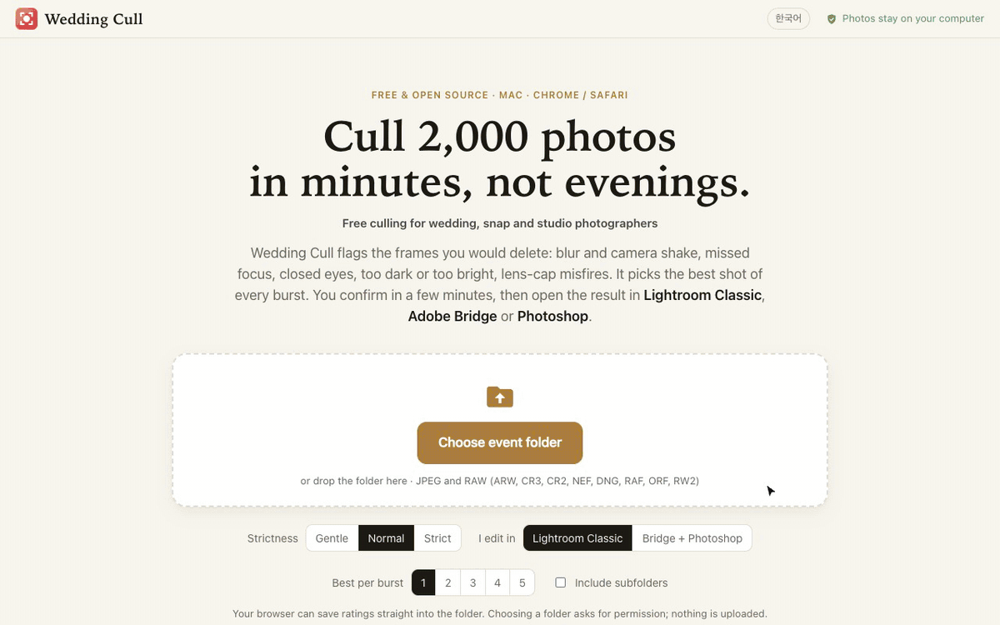
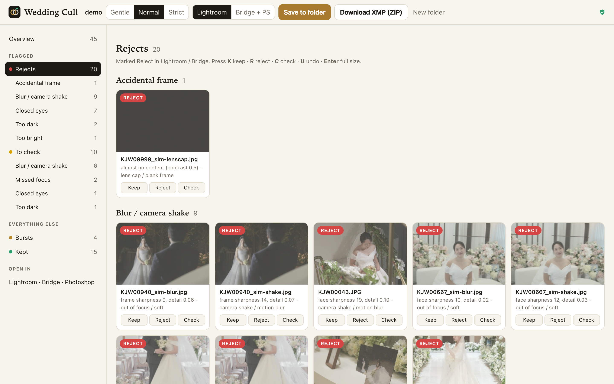
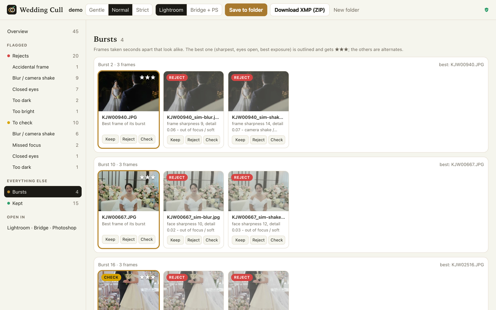
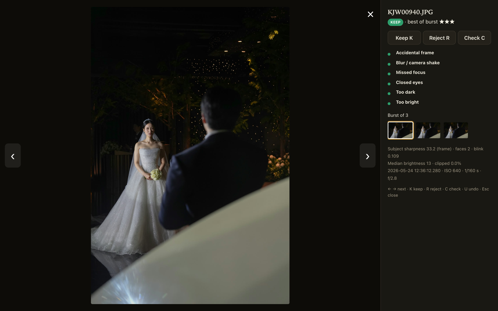
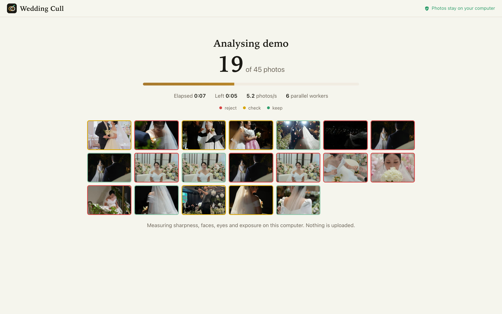
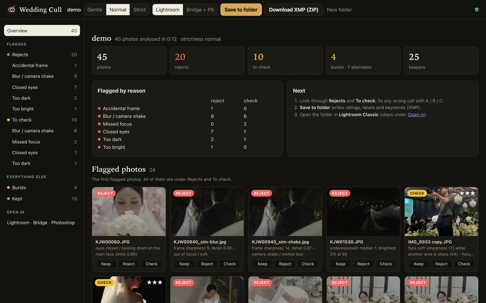
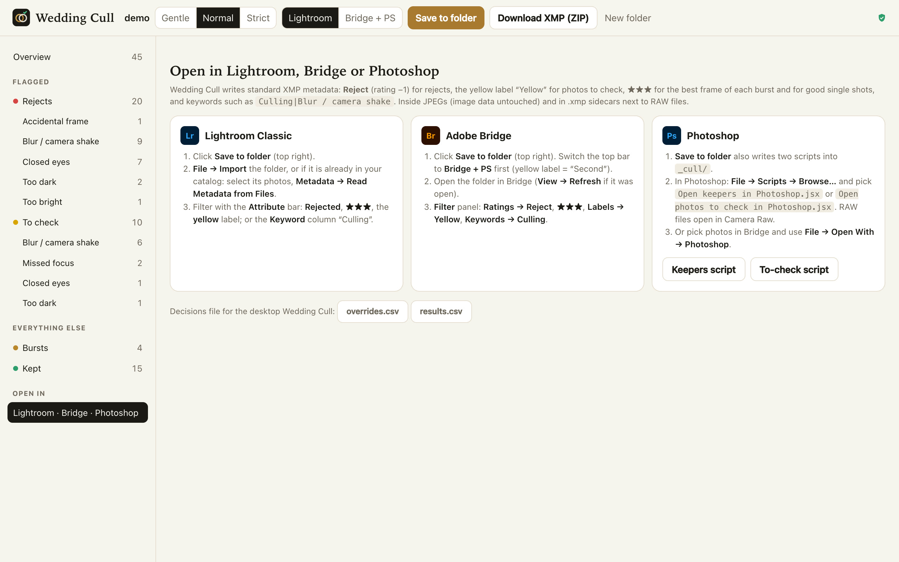

<div align="center">


# Wedding Cull

**Free photo culling for wedding photographers, right in your browser.**<br>
Flags blur, missed focus, closed eyes and bad exposure, picks the best frame of every burst,
and hands the result to **Lightroom Classic**, **Adobe Bridge** and **Photoshop**.<br>
Your photos never leave your computer.

### [**▶ Open Wedding Cull**](https://codingintheusa0402.github.io/wedding-cull-web/)

Mac and Windows · Chrome / Edge (Safari and Firefox: read-only mode) · nothing to install · MIT



<sub>Real speed. 45 full-size photos (Sony α7 IV, 14 to 33 MP), analysed on this computer. <a href="docs/media/demo.mp4">MP4, 1080p</a></sub>

</div>

---

## What it does

You shoot 2,000 frames. Wedding Cull looks at every one of them and shows you only the ones you would probably
delete or want to double-check, grouped by reason, so the review takes minutes instead of an evening.

| Check | How |
|---|---|
| **Blur and camera shake** | Multi-scale, direction-aware sharpness on the subject, not the whole frame: a sharp face on a creamy background is a keeper, not a blur reject. Camera shake is told apart from soft focus. |
| **Missed focus** | The face is soft while something else in the frame is sharp, so focus landed behind or in front of the couple. |
| **Closed eyes** | Faces are found (also small ones in full-length shots) and each main face gets a blink score. Blurry guests in the background are ignored. |
| **Too dark / too bright** | Histogram, clipped highlights and face brightness. Takes exposure compensation into account, so an intentional low-key or high-key shot is not flagged. |
| **Accidental frames** | Lens cap, ground, sky and misfires. |
| **Bursts** | Frames taken seconds apart that look alike are grouped. The best one (sharpest, eyes open, best exposed) gets ★★★ and the rest are marked as alternates. |

Then you confirm: <kbd>K</kbd> keep · <kbd>R</kbd> reject · <kbd>C</kbd> check · <kbd>U</kbd> undo, on a card or in the full-size view.

<table>
<tr>
<td width="50%"><br><sub><b>Rejects, grouped by reason</b>, each with the measurement that triggered it</sub></td>
<td width="50%"><br><sub><b>Bursts</b>: the sharp frame is starred, the blurred and shaken ones are rejected</sub></td>
</tr>
<tr>
<td><br><sub><b>Full size</b> with every check, the burst strip and the camera settings</sub></td>
<td><br><sub><b>Live progress</b>: count, speed, time left; red = reject, yellow = check</sub></td>
</tr>
<tr>
<td><br><sub><b>Overview</b> (dark mode follows your system)</sub></td>
<td><br><sub><b>Open in</b> Lightroom Classic, Bridge or Photoshop</sub></td>
</tr>
</table>

## How to use it

1. Open **[Wedding Cull](https://codingintheusa0402.github.io/wedding-cull-web/)** in **Chrome** or **Edge** (Mac or Windows).
2. Pick **Lightroom Classic** or **Bridge + Photoshop** under *I edit in*, and a strictness (*Normal* is a good start).
3. Click **Choose event folder** (straight from the SD card is fine) and allow access. JPEG and RAW (ARW, CR3, CR2, NEF, DNG, RAF, ORF, RW2).
4. Look through **Rejects** and **To check**. Fix any wrong call with K / R / C.
5. Click **Save to folder**. It shows exactly what it will write and asks first.

Your decisions and the analysis are remembered in this browser, so opening the same folder again is instant.

### Lightroom Classic

- **File → Import** the folder. If it is already in your catalog, select its photos and choose **Metadata → Read Metadata from Files**.
- Filter with the **Attribute** bar: *Rejected*, ★★★, the **yellow** label. Or use the **Keyword** column `Culling`.

### Adobe Bridge

- Open the folder (**View → Refresh** if it was already open).
- **Filter** panel: **Ratings → Reject**, ★★★, **Labels → Second** (Bridge's name for yellow), **Keywords → Culling**.

### Photoshop

- **Save to folder** also writes two scripts into `_cull/`: *Open keepers in Photoshop.jsx* and *Open photos to check in Photoshop.jsx*.
- In Photoshop: **File → Scripts → Browse…** and pick one. RAW files open in Camera Raw.
- Or select photos in Bridge and use **File → Open With → Photoshop**.

### What gets written

| | Reject | To check | Best of burst / good single |
|---|---|---|---|
| Rating | Reject (−1) | unchanged | ★★★ |
| Label | | yellow ("Yellow" for Lightroom, "Second" for Bridge) | |
| Keywords | `Culling\|Reject`, `Culling\|<reason>` | `Culling\|Check`, `Culling\|<reason>` | `Culling\|Best of burst` |

- **JPEG**: written *inside* the file's XMP block (Lightroom and Bridge ignore `.xmp` sidecars for JPEGs). Metadata only: the image data is copied byte for byte and checked before writing. The previous XMP block is backed up to `_cull/xmp_backup/`.
- **RAW**: an `.xmp` sidecar next to the photo. An existing sidecar (Camera Raw edits) keeps everything; only rating, label and the `Culling` keywords change, and the old one is backed up first.
- `_cull/results.csv` (every score), `_cull/overrides.csv` (your decisions) and the Photoshop scripts.
- **Nothing is moved, renamed or deleted.**

## Privacy

Everything runs in your browser tab: decoding, face detection and every measurement. There is no server, no upload,
no account and no analytics. The page loads its code and models from this repository once, and the browser caches them.
Face data never leaves the tab and is not stored.

## Speed

Measured on a MacBook Pro (M2 Pro) in Chrome: **270 full-size JPEGs (14 to 33 MP) in 50 seconds**, about 5.4 photos per
second, so **a 2,000-photo wedding takes about 6 minutes**. RAW files are read through their embedded full-size preview,
so they are about as fast. A second visit to the same folder reuses the results.

## Browsers

| | Analyse + review | Save to folder | Without saving |
|---|---|---|---|
| **Chrome, Edge** (Mac, Windows) | ✅ | ✅ | |
| **Safari**, **Firefox** | ✅ | — | **Download XMP (ZIP)**: unzip into the event folder. Works for **RAW**; for JPEG shoots use Chrome or Edge (Lightroom and Bridge read JPEG ratings only from inside the file) |

Tested on macOS: Chrome (full flow, including saving), Safari's WebKit engine (analysis and review). Firefox and Windows use the same code but have not been tested yet.

## How it works

Wedding Cull started as a desktop tool (Python, OpenCV, MediaPipe, Apple Vision). This web version is a line-by-line
port of its engine to JavaScript:

- **[OpenCV.js](https://docs.opencv.org/4.10.0/opencv.js)** for the sharpness, exposure, edge and burst measurements. On the same pixels, the web engine
  produces **exactly the same features and verdicts** as the desktop engine (57 of 57 test photos identical: `tests/parity.cjs`).
- **[YuNet](https://github.com/opencv/opencv_zoo/tree/main/models/face_detection_yunet)** finds faces, including small ones in full-length shots, and its boxes are mapped onto Apple Vision's geometry
  so the desktop's tuned thresholds still apply. **[MediaPipe Face Landmarker](https://ai.google.dev/edge/mediapipe/solutions/vision/face_landmarker)** scores blinks on each face.
  On 36 real wedding photos, the web version agrees with the desktop app on 31; the others are borderline calls.
- **Web Workers** use several CPU cores; nothing blocks the page.
- The browser's **File System Access API** reads the folder and writes the metadata (Chrome, Edge).

```
index.html, app.css, app.js   the page: folder access, review UI, saving
worker.js                     one photo in: decode, faces, measurements, thumbnail out
engine/core.js                thresholds, strictness, decisions, bursts, CSV (port of decide.py, bursts.py)
engine/analyze.js             measurements on OpenCV.js (port of analyze.py)
engine/files.js               EXIF, RAW previews, XMP inside JPEGs and in sidecars, ZIP
vendor/, models/              OpenCV.js, MediaPipe, face models (THIRD_PARTY_NOTICES.md)
tests/, tools/                parity, browser end-to-end and XMP tests; demo recorder
```

### Run it yourself

It is a static site, so any web server works:

```sh
git clone https://github.com/codingintheusa0402/wedding-cull-web.git
cd wedding-cull-web
python3 -m http.server 8000      # then open http://localhost:8000
```

Tests (Node 20+ and [Playwright](https://playwright.dev)'s `playwright-core`) are described in [tests/README.md](tests/README.md).

## Demo photos

The photos in the demo and screenshots are by **[owol.snap](https://www.instagram.com/owol.snap/)** and are shown with the couples'
permission. They are **not** covered by the MIT license and may not be reused. Files named `*_sim-blur`, `*_sim-shake`,
`*_sim-dark`, `*_sim-bright` and `*_sim-lenscap` are simulated defects made from those photos to show what Wedding Cull catches.

## License

Code: [MIT](LICENSE). Bundled libraries and models: see [THIRD_PARTY_NOTICES.md](THIRD_PARTY_NOTICES.md) (Apache-2.0, MIT).
